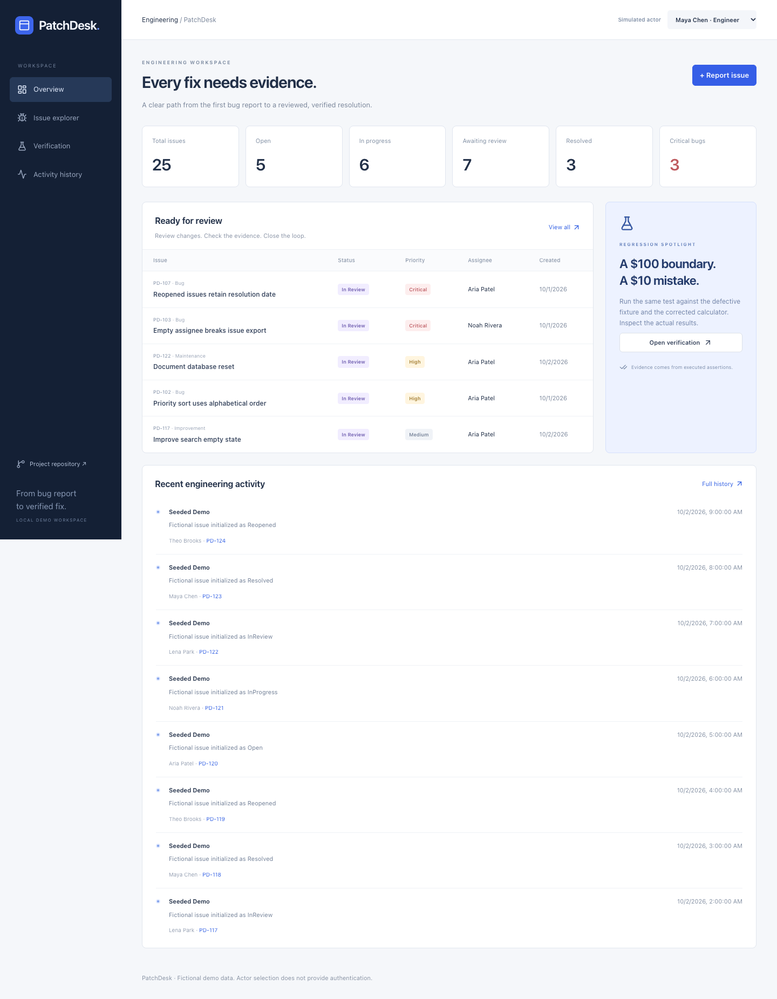

# PatchDesk

**From bug report to verified fix.**

PatchDesk is a miniature engineering workspace built with ASP.NET Core 10 and React. It connects a defect report to reproduction steps, ownership, a Git change, actual regression executions, and a reviewed resolution. The point is to preserve the evidence behind “fixed,” rather than treating resolution as an unchecked status update.

[CI runs](https://github.com/sarseej-shrestha/PatchDesk/actions/workflows/ci.yml) · [90-second demo](docs/demo.md) · [API](docs/api.md) · [Architecture](docs/architecture.md) · [Verification record](docs/verification.md)



## What works

- Issue creation, editing, deletion, assignment, comments, priority/severity, reproduction steps, and persisted activity history.
- Search, stable pagination, status/priority/assignee filters, and date/priority sorting.
- Explicit `Open → InProgress → InReview → Resolved → Reopened` workflow, validated by backend services.
- Version tokens reject stale writes; meaningful edits, new fix references, and reopening invalidate prior verification.
- A predefined regression registry executes real calculator assertions. It records failures and passes, execution source, duration, source commit, binary fingerprint, and history.
- Verified bug resolution requires **every associated test’s latest execution** to pass for the current evidence revision and latest linked fix commit. A dirty build cannot provide commit-bound verification.
- GitHub branch/commit/PR deep links and a read-only PR/check-run lookup. External failures never become fabricated successful checks.
- Dashboard, issue explorer/detail, verification workspace, and activity history with real API calls, loading/errors, accessible form labels, responsive layouts, and mutation feedback.

This is a **local portfolio prototype**. The actor selector uses five fictional developers and does not authenticate anyone. Do not expose the API publicly without implementing authentication and authorization.

## Stack and structure

.NET 10 · C# · ASP.NET Core controllers/OpenAPI · EF Core migrations · SQLite · xUnit/WebApplicationFactory · React 19 · strict TypeScript · Vite · Tailwind CSS · React Router · TanStack Query · Lucide · Playwright · GitHub Actions.

```text
backend/PatchDesk.Api/       Controllers, DTOs, services, entities, migrations, registry
backend/PatchDesk.Tests/     Unit, isolated SQLite/API integration, regression tests
frontend/src/               React pages, components, API client, types
frontend/e2e/               Chromium full-stack browser tests
scripts/                    Portable dotnet wrapper, browser checks, repeatable demo
docs/                       Architecture, API, testing, demo, observed evidence
.github/workflows/ci.yml    Backend, frontend, and browser CI jobs
```

The architecture is a modular monolith: HTTP controllers delegate to domain services, EF Core persists one relational database, and the frontend caches API responses. See the [architecture diagram and tradeoffs](docs/architecture.md).

## Install and run

Prerequisites: [official .NET 10 SDK](https://dotnet.microsoft.com/download/dotnet/10.0), [Node.js 24](https://nodejs.org/en/download), Git, and Python 3 for the optional scripted demo. Use a Git checkout: source provenance is captured at build time.

```bash
git clone https://github.com/sarseej-shrestha/PatchDesk.git
cd PatchDesk
./scripts/dotnet.sh restore backend/PatchDesk.sln --locked-mode
./scripts/dotnet.sh tool restore
npm --prefix frontend ci
```

The wrapper uses a repository-local `.tools/dotnet` SDK when present, otherwise `dotnet` from `PATH`. On the implementation workstation Node 24 is also installed locally; select it with `export PATH="$PWD/.tools/node/bin:$PATH"`. Normal installations do not need that export. `global.json` selects .NET 10, and `.nvmrc` selects Node 24.

Apply the committed migration and load deterministic sample data:

```bash
./scripts/dotnet.sh run --project backend/PatchDesk.Api --no-launch-profile -- --migrate --seed
```

Seed data includes 25 issues (12 bugs, five feature requests), five fictional developers, comments, labeled fictional histories, and two associated regression tests. Seeding does not invent passing executions. The [demo script](docs/demo.md) produces real failing/passing evidence and a verified resolution.

Start the backend in one terminal:

```bash
./scripts/dotnet.sh run --project backend/PatchDesk.Api
```

Start the frontend in another:

```bash
npm --prefix frontend run dev
```

Open **http://127.0.0.1:5173**. API: `http://127.0.0.1:5080/api`; OpenAPI JSON: `http://127.0.0.1:5080/openapi/v1.json`. Vite proxies `/api` and `/openapi` to the backend, so no broad CORS policy is needed.

For a new migration after changing the model:

```bash
./scripts/dotnet.sh ef migrations add DescribeChange --project backend/PatchDesk.Api
./scripts/dotnet.sh run --project backend/PatchDesk.Api --no-launch-profile -- --migrate
```

To **delete the local database and recreate the demo**, stop the API first:

```bash
./scripts/dotnet.sh run --project backend/PatchDesk.Api --no-launch-profile -- --reset --seed
```

The default database is `backend/PatchDesk.Api/patchdesk.db`. Override it with `ConnectionStrings__PatchDesk='Data Source=/absolute/path/patchdesk.db'`. Schema changes are applied explicitly; ordinary startup never deletes or silently recreates data.

## Test and verify

```bash
./scripts/dotnet.sh build backend/PatchDesk.sln --configuration Release --no-restore
./scripts/dotnet.sh test backend/PatchDesk.sln --configuration Release --no-restore --logger trx
npm --prefix frontend run lint -- --max-warnings 0
npm --prefix frontend run typecheck
npm --prefix frontend run build
npm --prefix frontend exec -- playwright install chromium
./scripts/browser-check.sh
```

Stop any manually running API/Vite instances before browser tests: they launch their own servers on ports 5080/5173 and use a separate `.tools/patchdesk.e2e.db`. On Linux install browser system dependencies with `npx playwright install --with-deps chromium` from `frontend/`.

Observed baseline: **51 backend cases (30 unit, 20 integration, one health) and four Chromium cases pass**, locally and in [GitHub Actions](https://github.com/sarseej-shrestha/PatchDesk/actions/runs/38706832614). The browser suite performs real creation, assignment, comments, reload persistence, test execution, commit linking, resolution/reopening, and mobile navigation. Compilation is reported separately from browser behavior. See [testing](docs/testing.md) and the [dated verification record](docs/verification.md).

CI runs on pushes and pull requests with .NET 10 and Node 24, restores locked dependencies, treats C# warnings as errors, runs ESLint/strict types, checks migration drift, applies the schema, and uploads TRX/coverage, frontend, and browser artifacts. No production secrets are required. Builds are verified; there is no automatic production deployment.

## Reproduce the engineering workflow

With the API running from a **clean, committed build**:

```bash
python3 scripts/demo.py --output .tools/demo-evidence.json
```

This calls the real REST API, links the running build commit, executes the defective and corrected fixtures, records actual outputs, moves the issue through review, and resolves it as the simulated reviewer. It can be rerun: a resolved issue is reopened first. [The recorded evidence snapshot](docs/demo-evidence.json) includes the exact historical build commit and timestamps; rerunning generates fresh evidence for your build.

The defective implementation is isolated in `DefectiveDiscountFixture`; production uses `DiscountCalculator`. The production test suite asserts that the defective fixture fails and the corrected fixture passes, so the demonstration does not require committing a broken final test suite.

## Configuration and limitations

- Demo actor/role checks are workflow simulation, **not security boundaries**. There is no real authentication, authorization, tenancy, or audit tamper resistance.
- SQLite is suitable for this local prototype; multi-instance deployment, load testing, backup/retention, and operational monitoring are outside scope.
- The registry contains three invoice-calculator assertions. It does not execute arbitrary scripts or verify unrelated bugs automatically. Add reviewed repository tests to extend it, or use the explicitly labeled manual override with a reason.
- Local registry evidence is not a CI attestation. Source commit and binary hash establish build provenance within the prototype; they are not cryptographic remote attestation.
- GitHub links validate syntax and repository scope. Stored references alone do not prove existence, review, or successful CI. PR lookup retrieves up to 100 check runs; it does not fetch legacy commit statuses or enforce merge protection.
- Optional `GitHub__Token` is read only by the backend. Public lookup works without it subject to GitHub rate limits. Never put tokens in frontend settings or Git.
- No optional board view, additional charts, Docker deployment, attachments, or arbitrary CI-result importer was added. OpenAPI JSON is available; no bundled Swagger UI is included.
- Deletion removes an unresolved issue and its child records after UI confirmation. Resolved issues must be reopened first. This is not an immutable compliance archive.

[Design rationale](docs/architecture.md) · [API examples](docs/api.md) · [Interview notes and truthful resume bullets](docs/interview.md) · [Branch and attribution record](docs/implementation.md)
