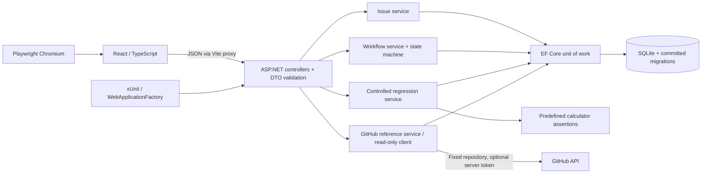
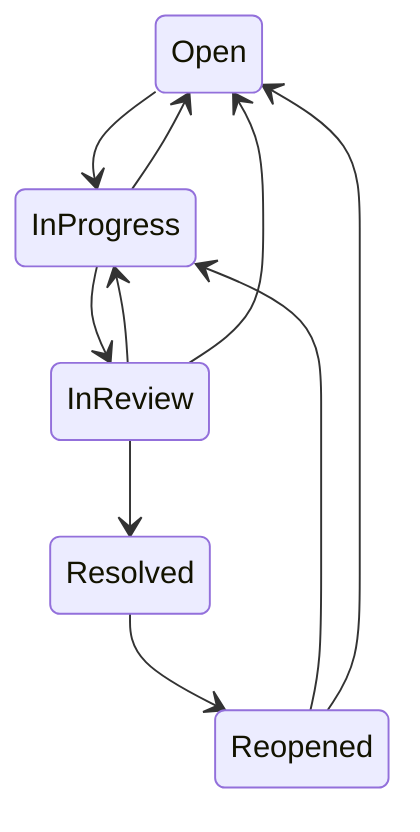

# Architecture

PatchDesk is a modular monolith with one ASP.NET Core process, one SQLite database, and a React client. The design keeps HTTP handling separate from business rules without introducing microservices, messaging, or a generic repository over EF Core.

## Boundaries

- **Controllers** bind requests, use DataAnnotations validation, return appropriate HTTP statuses, and delegate operations. Request/response DTOs keep persistence entities out of the public contract. Unknown JSON members and integer enum values are rejected.
- **IssueService** owns issue mutations, actor lookup, filtering, current-version checks, activity recording, and common load operations.
- **WorkflowEngine** is a deterministic state machine with a pure validation interface. **WorkflowService** applies validated transitions, timestamps, resolution labels, revision invalidation, and activity records atomically.
- **RegressionRegistry** contains reviewed test definitions, expected values, and a bounded execution path. Both xUnit and the API use its assertions; the server never shells out to user-provided commands.
- **RegressionService** associates known identifiers, executes their assertions, and persists genuine results. Callers cannot provide result labels, timestamps, or commit identities.
- **GitHubReferenceService** validates repository-specific references. **GitHubClient** retrieves PR/check data from a fixed GitHub base URL, with a timeout and explicit upstream-error handling.
- **PatchDeskDbContext** is the transaction boundary. One `SaveChangesAsync` commits an issue mutation and its activity/evidence records together.

## Data model

`Issue` references a reporter and optional assignee in `Developer`. It owns comments, activities, regression associations, and fix references. A regression association owns immutable execution rows. Developers are restricted from cascading deletion; deleting an issue cascades to its child records.

The migration includes foreign keys, unique developer email and per-issue test-identifier indexes, query indexes, enum bounds, a nonblank bounded title check, positive version/revision checks, and execution-result/duration constraints. The generated EF snapshot is committed. CI rejects model/migration drift and applies the schema to a real SQLite database.

Two integer values serve different purposes:

| Value | Purpose | Changes when |
|---|---|---|
| `Version` | Optimistic concurrency token | Any issue aggregate mutation, including comments and execution records |
| `EvidenceRevision` | Verification freshness | Fields change, tests are associated, fixes are linked, issue reopens, or work moves back from review |

A mutation includes the observed `Version`. An early comparison gives an understandable conflict response; EF's concurrency predicate catches races after that comparison. The losing transaction rolls back its accompanying records. SQLite concurrency is tested with simultaneous HTTP assignments and independently loaded EF contexts.

## Workflow and verification

Review requires an assignee. Resolution requires a note and a selected fictional reviewer. For bugs, standard resolution additionally requires:

1. At least one registered test association and a full commit hash on the latest fix reference.
2. The latest execution of **each** association passed, came from the controlled registry, and did not use the defective fixture.
3. Every execution matches the issue's current evidence revision and the latest linked commit.

A build captures its Git revision and whether the source checkout was clean. Each execution records the assembly SHA-256. Dirty/unversioned builds may run assertions but cannot provide commit-bound verified evidence. Adding a newer fix invalidates old results even if an earlier commit passed. A later failing or defective run supersedes an earlier pass for the same association. Reopening clears the resolution timestamp and note and invalidates verification.

Manual override is intentionally separate: an explicit reason, note, and simulated reviewer are required; `ResolutionOverridden` and `ResolvedWithManualOverride` preserve the distinction. Selecting a reviewer does not authenticate that person.

## Frontend

React Router defines the five workspace views. TanStack Query owns server state; successful mutations invalidate cached queries. Forms send versions from the loaded issue. The server remains authoritative when a stale client attempts a transition. API errors appear in the form/loading state or a notification, never as a fabricated successful result.

Vite proxies API traffic during development. There is no permissive cross-origin policy. The application supports desktop layout and mobile navigation, with horizontally scrollable issue tables where needed. Static production bundles are generated by CI; hosting them with an API reverse proxy is a deployment concern outside this prototype.

## Tradeoffs

- SQLite makes local setup and isolated integration testing simple, but is not presented as a multi-tenant production design.
- A controlled in-process registry avoids arbitrary execution while making the proof reproducible. It is intentionally narrower than a general CI importer.
- Client-provided actor IDs are honest simulation. Production use needs identity, access control, antiforgery decisions, rate limiting, and retention requirements designed for its deployment.
- GitHub lookup is read only; storage is still usable when GitHub is unavailable. No external check result is inferred from a branch name or PR link.
- History records preserve operations while an issue exists. Explicit deletion is not an immutable audit archive.
